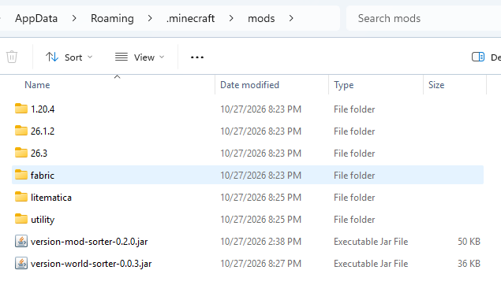
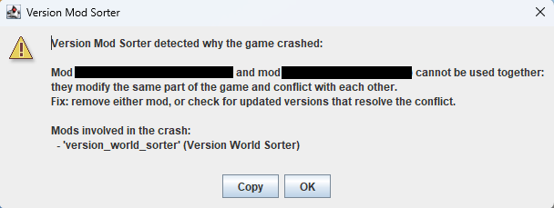
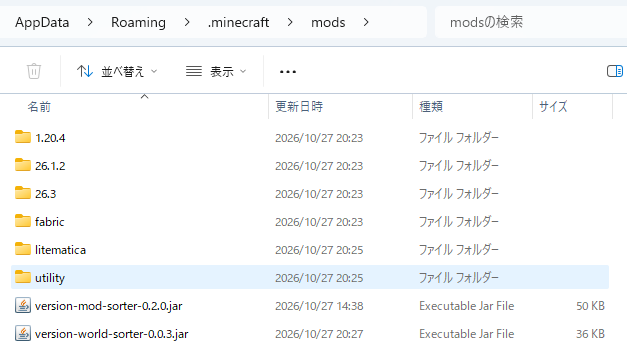

[日本語版はこちら / Japanese](#japanese)

# Version Mod Sorter (VMS)

A mod that lets you sort mods into subfolders inside your `mods` folder. Name a folder after a loader or a Minecraft version, and the mods inside it are loaded only when the game runs with that loader or version. Supports Fabric, Forge, and NeoForge.

## Requirements

- Fabric Loader 0.13.0+ / Forge 41.1.0 (Minecraft 1.19)+ / NeoForge 20.6.62-beta (Minecraft 1.20.6)+
- You don't need a separate jar for each loader or Minecraft version — a single jar works across the entire supported range.

## Installation

Download the latest `version-mod-sorter-x.x.x.jar` from [Releases](../../releases) and put it in your `mods` folder, just like any other mod.

## Usage

Create subfolders inside the `mods` folder and put your mods in them. Whether a mod in a subfolder is loaded depends on the folder names.

| Folder name | Loaded when |
|---|---|
| `fabric` / `forge` / `neoforge` | The game runs with that loader |
| A name containing `.` (e.g. `1.21.1`, `Disabled.Mod`) | Only when the name matches the current Minecraft version. Otherwise, mods in it are not loaded |
| Anything else (e.g. `utility`) | Always |

Folders can be nested. The order and depth are up to you. A mod is loaded only when every folder on its path (excluding `mods` itself) meets its condition. For example, a mod in `mods/fabric/1.21.1/` is loaded only when the game runs on Fabric with Minecraft 1.21.1. `mods/1.21.1/fabric/` works the same way.

Mods placed directly in the `mods` folder are always loaded, as before.

When you launch the game, folders for the current Minecraft version and loader (e.g. `mods/1.21.1/`, `mods/fabric/1.21.1/`) are created automatically.

### Example Layouts

**Using only one loader**
If you only want to separate mods by version, you don't need a loader folder.
- mods/**1.21.1**/mod.jar

**Switching between loaders and versions**
You can share one game folder across multiple versions and loaders without swapping mods.
- mods/**fabric**/**1.21.1**/mod.jar

**Organizing by category only (no loader or version folders)**
- mods/utility/mod.jar

**Temporarily disabling a mod**
- mods/**Disabled.Mod**/mod.jar

### Quick Reference

| Location | Fabric 1.21.1 | Fabric 1.20.1 | Forge 1.21.1 |
|---|:---:|:---:|:---:|
| mods/ (root) | ✅ | ✅ | ✅ |
| mods/utility/ | ✅ | ✅ | ✅ |
| mods/**fabric**/ | ✅ | ✅ | ❌ |
| mods/**1.21.1**/ | ✅ | ❌ | ✅ |
| mods/**fabric**/**1.21.1**/ | ✅ | ❌ | ❌ |
| mods/**Disabled.Mod**/ | ❌ | ❌ | ❌ |

### Folder Name Pitfalls

- A version folder name must exactly match the current Minecraft version. `1.21` and `1.21.0` are treated as different versions.
- If you include a `.` in a folder name meant for organizing, it is treated as a version name and will not be loaded (e.g. `Create 0.5`).
- Folders named `fabric`, `forge`, or `neoforge` are treated as loader conditions. Names are not case-sensitive.

## Temporarily Disabling Mods

A folder named `Disabled.Mod` is created at launch. Mods inside it are not loaded, so you can use it to set mods aside without deleting them. Besides the root of `mods`, it is also created inside the folders for the current loader and version, such as `mods/fabric/` and `mods/1.21.1/`.

`Disabled.Mod` is not loaded because a name containing `.` does not match any version name. Using this rule, you can also create an exclusion folder with any name you like (e.g. `old.mods`).

## How It Works

At launch, VMS detects the current loader and Minecraft version, then loads mods from the subfolders whose conditions match. It uses each loader's official mechanism (Fabric's `fabric.addMods`, Forge/NeoForge's mod discovery API) and does not modify any Minecraft classes or bytecode. This is why a single jar supports all three loaders.

## Crash Analysis (Fabric)

When the game crashes on Fabric, VMS analyzes the cause and shows a dialog. It checks crash reports (`crash-reports/`) first, then falls back to the tail of `logs/latest.log`. This feature works only when at least one mod is loaded from a subfolder.

It detects two kinds of crashes and, for each, shows the involved mods and suggested fixes:

- **Mod conflicts** — when multiple mods modify the same code and collide, both mod names are shown with the suggestion to remove one or check for updates
- **Version mismatch** — when a mod references code that does not exist in the current Minecraft version, the mod name is shown with the suggestion to move it to the matching version folder, or to update or remove it

For crashes that match neither category, VMS still lists mods inferred from the stack trace. If the loader itself reports a mod resolution failure (`Mod resolution failed`, etc.), VMS does not show a second notification because the loader already shows its own error screen.

## Tested Environments

- Windows 11 — Fabric Loader 0.19.2 / Forge 44.1.23 (MC 1.19.3) / Forge 54.1.16 (MC 1.21.4) / Forge 62.0.9 (MC 26.1) / Forge 64.0.8 (MC 26.1.2) / NeoForge 21.4.157 / NeoForge 26.1.2.66-beta
- macOS (Apple M2) — Fabric Loader 0.19.2 (MC 1.20.4)
- Folder rules verified (Windows 11, dedicated server) — Fabric Loader 0.19.3 / Forge 65.0.0 / NeoForge 26.2.0.7-beta (MC 26.2)

## Notes

- On Fabric, if at least one mod is loaded from a subfolder, VMS restarts the game once, so startup happens in two stages. Forge and NeoForge do not restart.
- If you put the same mod in more than one folder whose conditions match at the same time, it gets loaded twice and may cause an error.
- Snapshot versions of Minecraft are not guaranteed to work.
- This mod relies on internal loader implementations, so a major loader update may cause it to stop working. Even then, it does not modify Minecraft or the loader itself, so only VMS stops working — the game and other mods will be fine.
- For the folder rules in 0.1.x and earlier, see [this page](docs/spec-0.1.x.md).

## Related Mods

- [Version World Sorter](../../../Version-World-Sorter) — VMS lets you share one game folder across multiple versions, but as a result, the world selection screen also shows worlds that don't match the current version. Opening a world with the wrong version can corrupt it. Version World Sorter hides worlds that don't match the current Minecraft version from the world selection screen to prevent this. The two work well together, but either can be used on its own.

## Support

Please report bugs and ask questions via [Issues](../../issues).

---

# Version Mod Sorter（VMS）

`mods` フォルダの中にサブフォルダを作って、Modを仕分けできるようにするModです。フォルダ名をローダー名やMinecraftのバージョンにすると、そのローダー・バージョンで起動したときだけ読み込むようにすることもできます。Fabric・Forge・NeoForgeに対応しています。

## 動作環境

- Fabric Loader 0.13.0 以降 / Forge 41.1.0（Minecraft 1.19）以降 / NeoForge 20.6.62-beta（Minecraft 1.20.6）以降
- 対応範囲内であれば、ローダーやMinecraftのバージョンごとに別のjarを用意する必要はありません。1つのjarで動作します。

## 導入

[Releases](../../releases)から最新の `version-mod-sorter-x.x.x.jar` をダウンロードし、通常のModと同じように `mods` フォルダに入れてください。

## 使い方

`mods` フォルダの中にサブフォルダを作り、Modを入れてください。サブフォルダに入れたModは、フォルダ名に応じて読み込むかどうかが決まります。

| フォルダ名 | 読み込まれる条件 |
|---|---|
| `fabric` / `forge` / `neoforge` | そのローダーで起動したとき |
| `.` を含む名前（例: `1.21.1`、`Disabled.Mod`） | 名前が起動中のMinecraftのバージョンと一致したときだけ。一致しなければ読み込まれない |
| 上記以外（例: `便利系`） | いつでも |

フォルダは入れ子にできます。順番や深さは自由で、Modまでのパス上にあるすべてのフォルダ（`mods` 自身を除く）の条件を満たしたときだけ読み込まれます。例えば `mods/fabric/1.21.1/` に入れたModは、「Fabricで、かつバージョン1.21.1で起動したとき」だけ読み込まれます。`mods/1.21.1/fabric/` でも同じです。

`mods` フォルダ直下のModは、これまで通りいつでも読み込まれます。

ゲームを起動すると、そのときのMinecraftバージョンとローダーに対応するフォルダ（例: `mods/1.21.1/`、`mods/fabric/1.21.1/`）が自動で作られます。

### 置き方の例

**ローダーを1つしか使わない**
バージョンごとに分けるだけなら、ローダーのフォルダは要りません。
- mods/**1.21.1**/mod.jar

**ローダーもバージョンも使い分ける**
1つのゲームフォルダを複数のバージョン・ローダーで使い回しても、Modの入れ替えは不要です。
- mods/**fabric**/**1.21.1**/mod.jar

**分けずに種類ごとに整理したい**
- mods/便利系/mod.jar

**一時的に外したい**
- mods/**Disabled.Mod**/mod.jar

### 早見表

| 置き場所 | Fabric 1.21.1 | Fabric 1.20.1 | Forge 1.21.1 |
|---|:---:|:---:|:---:|
| mods/（直下） | ✅ | ✅ | ✅ |
| mods/便利系/ | ✅ | ✅ | ✅ |
| mods/**fabric**/ | ✅ | ✅ | ❌ |
| mods/**1.21.1**/ | ✅ | ❌ | ✅ |
| mods/**fabric**/**1.21.1**/ | ✅ | ❌ | ❌ |
| mods/**Disabled.Mod**/ | ❌ | ❌ | ❌ |

### フォルダ名の注意

- バージョン名は、起動中のMinecraftのバージョンと完全に一致する名前にしてください。`1.21` と `1.21.0` は別のバージョンとして扱われます。
- 整理用のフォルダ名に `.` を入れると、バージョン名として扱われて読み込まれなくなります（例: `Create 0.5`）。
- `fabric`・`forge`・`neoforge` という名前のフォルダは、ローダーの条件として扱われます。大文字・小文字は区別しません。

## Modを一時的に無効にしたいとき

起動時に `Disabled.Mod` というフォルダが作られます。ここに入れたModは読み込まれないので、削除せずに退避させる場所として使えます。`mods` 直下のほか、`mods/fabric/` や `mods/1.21.1/` など、起動したローダー・バージョンのフォルダの中にも作られます。

`Disabled.Mod` が読み込まれないのは、`.` を含む名前がバージョン名と一致しないためです。この仕組みを利用すれば、自分で好きな名前の除外フォルダ（例: `old.mods`）を作ることもできます。

## 仕組み

起動時に実行中のローダーとMinecraftバージョンを判定し、条件に合うサブフォルダのModを読み込みます。読み込みには各ローダー公式の仕組み（Fabricの `fabric.addMods`、Forge・NeoForgeのMod探索API）を使い、Minecraftのクラスやバイトコードは書き換えません。そのため1つのjarで3つのローダーに対応できます。

## クラッシュ解析（Fabric）

Fabricでゲームがクラッシュしたとき、原因を解析してダイアログで通知します。クラッシュレポート（`crash-reports/`）を優先し、なければ `logs/latest.log` の末尾を調べます。この機能は、サブフォルダから読み込むModが1つでもある場合のみ動作します。

以下の2種類を検出し、それぞれについて関与したModと修正案を表示します。

- **Mod同士の競合** — 複数のModが同じコードを書き換えて衝突した場合、両方のMod名を示して「どちらかを外すか更新を確認してください」と案内します
- **バージョン不整合** — 現在のMinecraftバージョンに存在しないコードをModが参照している場合、該当Mod名を示して「対応するバージョンのフォルダへ移動するか、更新・削除してください」と案内します

どちらにも該当しないクラッシュでも、スタックトレースから関与したModを推定して一覧で示します。原因がローダー自身のMod解決失敗（`Mod resolution failed` 等）だった場合は、ローダーが独自のエラー画面を出すため、VMSは二重に通知しません。

## テスト済み環境

- Windows 11 — Fabric Loader 0.19.2 / Forge 44.1.23（MC 1.19.3）/ Forge 54.1.16（MC 1.21.4）/ Forge 62.0.9（MC 26.1）/ Forge 64.0.8（MC 26.1.2）/ NeoForge 21.4.157 / NeoForge 26.1.2.66-beta
- macOS（Apple M2） — Fabric Loader 0.19.2（MC 1.20.4）
- フォルダルールの確認（Windows 11・サーバー） — Fabric Loader 0.19.3 / Forge 65.0.0 / NeoForge 26.2.0.7-beta（MC 26.2）

## 注意点

- Fabricでは、サブフォルダから読み込むModが1つでもある場合、VMSが一度だけゲームを再起動するため、起動が二段階になります。Forge・NeoForgeでは再起動は行いません。
- 同じModを同時に読み込まれる複数のフォルダに入れると、二重に読み込まれてエラーになることがあります。
- スナップショット版のMinecraftでの動作は保証していません。
- 各ローダーの内部実装を利用しているため、ローダーの大型アップデートで読み込みが機能しなくなる場合があります。その場合でも、Minecraft本体やローダーの書き換えは行っていないため、VMSが働かなくなるだけで、ゲーム自体やほかのModへの影響はありません。
- 0.1.x 以前の仕様は[こちら](docs/spec-0.1.x.md)を参照してください。

## 関連Mod

- [Version World Sorter](../../../Version-World-Sorter) — VMSを使うと1つのゲームフォルダを複数のバージョンで使い回せますが、その分、ワールド選択画面には現在のバージョンに合わないワールドも表示されます。バージョンの合わないワールドを誤って開くと、破損する恐れがあります。Version World Sorterは、現在のMinecraftバージョンに合わないワールドをワールド選択画面から非表示にして、この事故を抑制するModです。VMSと組み合わせると効果的ですが、どちらも単体で使えます。

## 問い合わせ

不具合の報告や質問は [Issues](../../issues) からお願いします。
